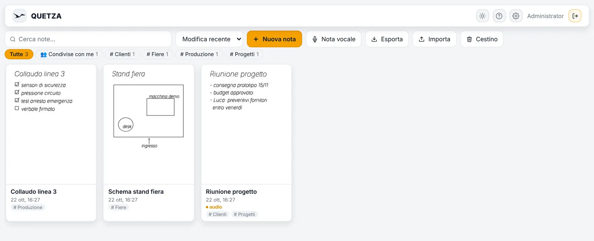
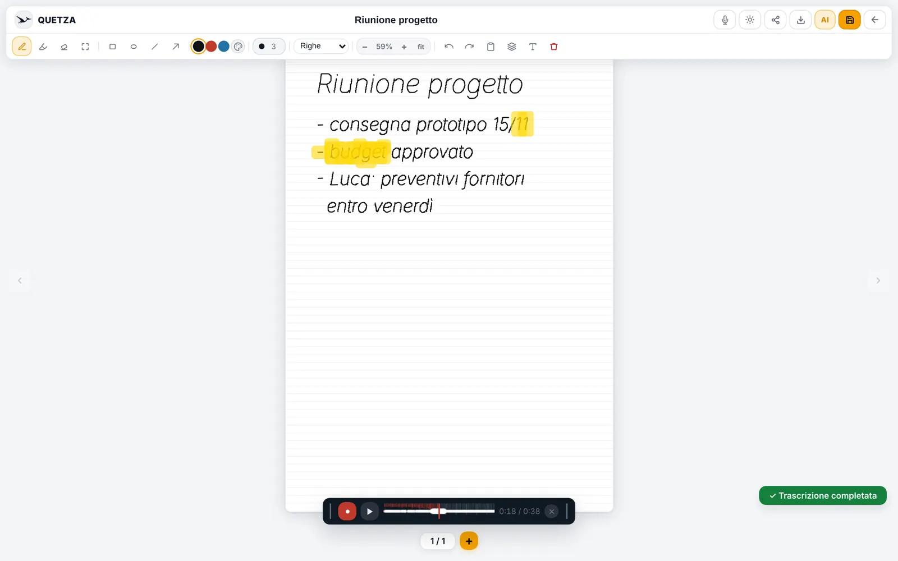
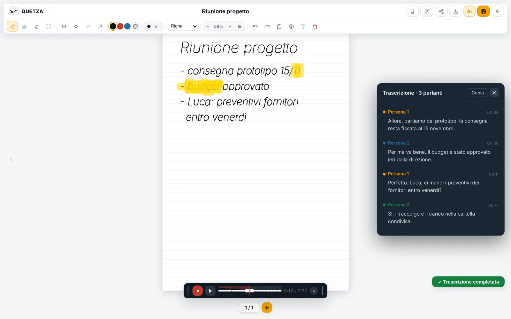

<p align="center">
  <picture>
    <source media="(prefers-color-scheme: dark)" srcset="docs/img/quetza-dark.gif">
    
  </picture>
</p>

<h1 align="center">Quetza</h1>

<p align="center">
  <b>Appunti a mano con l'audio della riunione.<br>Sul server della tua organizzazione, non nel cloud.</b>
</p>

<p align="center">
  
  
  
  <a href="LICENSE"></a>
</p>

Quetza è un quaderno nel browser per chi prende appunti in riunione.
Scrivi a penna su fogli A4 mentre registri: ogni tratto ricorda l'istante in cui l'hai scritto, e quando riascolti vedi illuminarsi quello che stavi scrivendo.
A fine registrazione l'audio viene trascritto sul server, distinguendo chi parla, e diventa cercabile.
Gli utenti entrano con l'account aziendale (LDAP o SSO) e niente esce dalla rete.

<p align="center">
  
</p>

## ✨ Cosa sa fare

<table>
  <tr><td width="32%">✍️ <b>Scrittura a mano vera</b></td><td>Penna con pressione su iPad, Android e Windows, evidenziatore, gomma, lasso, forme, frecce, testo, immagini. Più pagine A4 per nota, con righe, quadretti o puntini.</td></tr>
  <tr><td width="32%">🎙️ <b>Audio sincronizzato</b></td><td>Registri mentre scrivi. Riascoltando, i tratti di quel momento si illuminano; clicchi la forma d'onda e salti lì.</td></tr>
  <tr><td width="32%">📝 <b>Trascrizione automatica</b></td><td>Whisper gira in un container accanto all'app: niente audio verso servizi esterni. Riconosce chi parla e la trascrizione entra nella ricerca.</td></tr>
  <tr><td width="32%">🔎 <b>Ricerca</b></td><td>Trova le note dal titolo, dal testo digitato e da quello che è stato detto in riunione.</td></tr>
  <tr><td width="32%">🔗 <b>Condivisione</b></td><td>Link di sola lettura, con scadenza, per chi non ha un account. Export in PDF di tutte le pagine.</td></tr>
  <tr><td width="32%">🏢 <b>Pronta per l'organizzazione</b></td><td>Account locali, LDAP / Active Directory e SSO con qualsiasi provider OIDC. Pannello di amministrazione, logo e nome dell'organizzazione.</td></tr>
  <tr><td width="32%">💾 <b>Backup ogni notte</b></td><td>Copia coerente del database in una cartella del server, pronta da portare sul NAS. Export e import completi per cambiare server.</td></tr>
  <tr><td width="32%">📱 <b>Ovunque</b></td><td>Computer, tablet e telefono. Si installa come app (PWA). Tema chiaro, scuro ed e-ink.</td></tr>
</table>

<table>
  <tr>
    <td width="50%"><br><sub>Riascoltando si illumina quello che stavi scrivendo</sub></td>
    <td width="50%"><br><sub>Trascrizione divisa per persona</sub></td>
  </tr>
</table>

## 🚀 Pronto in cinque minuti

Serve un server Linux con Docker e il plugin Compose, raggiungibile dagli utenti nella LAN.

```bash
git clone https://github.com/ranzaWARE/quetza.git
cd quetza
./installa.sh
```

Lo script crea il file `.env` con un segreto casuale, chiede IP e nome del server, costruisce e avvia i container e stampa l'indirizzo, ad esempio `https://192.168.1.20:8443`.

1. Entra con **admin** / **admin**: Quetza chiede subito una nuova password.
2. Da **Amministrazione** (l'ingranaggio) crea gli utenti oppure collega LDAP o SSO.
3. Al primo avvio il container di trascrizione scarica il modello: dopo qualche minuto *Amministrazione → Whisper → Test connessione* risponde.

Per aggiornare: `git pull && ./installa.sh` (il `.env` resta com'è).

## 📖 La guida

La **guida illustrata** è dentro l'app: pulsante **?** in alto, oppure `https://<server>:8443/guida.html`.
Spiega l'uso quotidiano a chi prende appunti e, nella seconda parte, installazione, configurazione, backup e accessi a chi gestisce il server.
È un file unico: si può anche salvare o stampare.

## ⚙️ Configurazione

Tutto sta nel file `.env`, commentato riga per riga ([`.env.example`](.env.example)). Le voci principali:

| Variabile | A cosa serve |
|---|---|
| `SESSION_SECRET` | Obbligatoria. La genera `installa.sh`. |
| `SERVER_IP`, `SERVER_NAME` | Indirizzo e nome del server, per il certificato. |
| `ORG_NAME` | Nome dell'organizzazione nella pagina di accesso. |
| `QUETZA_HTTPS_PORT`, `QUETZA_HTTP_PORT` | Porte (8443 e 8080). La HTTP fa solo il redirect a HTTPS. |
| `BACKUP_PATH`, `BACKUP_KEEP` | Dove finiscono i backup notturni e quanti tenerne. |
| `WHISPER_MODEL`, `HF_TOKEN` | Modello di trascrizione e token per distinguere chi parla. |
| `LDAP_*`, `OIDC_INTERNAL_URL` | Accesso aziendale (si configura anche dal pannello). |

Accanto a `docker-compose.yml` ci sono quattro cartelle:

| Cartella | Cosa metterci |
|---|---|
| `certs/` | `server.crt` e `server.key` emessi dalla CA aziendale. Se mancano, Quetza ne genera uno self-signed. |
| `backups/` | Qui arrivano i backup notturni. **Copiala fuori dal server.** |
| `ca/` | Certificati delle CA interne di cui fidarsi per LDAPS e SSO. |
| `logo/` | `logo.svg` o `logo.png` dell'organizzazione, per l'intestazione. |

## 🔐 Accesso

- **Locale**: utenti creati nel pannello, password con scrypt.
- **LDAP / Active Directory**: nome utente e password di Windows, con un account di servizio in sola lettura.
- **SSO (OIDC)**: Quetza fa solo da client e funziona con il provider che avete già (Keycloak, Microsoft Entra ID, Authentik, Google Workspace…). **Non installa nessun provider.** Usa PKCE e nonce e legge gli endpoint dalla discovery.

Gli account locali restano sempre utilizzabili: se l'AD o il provider SSO non rispondono, l'amministratore entra comunque.

## 🛡️ I dati

- Note, audio, trascrizioni e utenti stanno in un database SQLite nel volume `quetza_data`.
- Ogni notte una copia coerente va in `backups/` (ultime 30). Ripristino e aggiornamento sono spiegati nella guida.
- Nessun servizio esterno, nessun CDN: Internet serve solo per installare e per scaricare i modelli di trascrizione.
- Solo HTTPS per gli utenti; utenti disattivati e permessi revocati hanno effetto subito.

## ⚖️ Limiti, detti chiaramente

- La scrittura a mano **non viene letta** (niente OCR): la ricerca trova titolo, testo digitato e trascrizione.
- Su tablet si scrive **con la penna**; il dito sposta e ingrandisce il foglio. Senza penna, sul telefono, restano comode le note vocali.
- La trascrizione gira su CPU: per una riunione di un'ora possono servire decine di minuti, una registrazione alla volta.
- Con il certificato self-signed i browser mostrano un avviso e alcuni bloccano il microfono: in produzione usate un certificato della CA aziendale.
- I link condivisi sono leggibili da chiunque abbia il link: usate la scadenza per le note riservate.
- Un solo server: niente alta affidabilità. Il backup notturno va portato altrove.

---

<p align="center"><i>Il nome viene dal <b>Quetzalcoatlus</b>, lo pterosauro più grande mai esistito. Open source, licenza MIT.</i></p>

---

## 👩‍💻 Per chi sviluppa

<details>
<summary><b>Com'è fatta</b></summary>

| Cartella | Cosa contiene |
|---|---|
| `backend/` | Express + SQLite (better-sqlite3): API, autenticazione locale/LDAP/OIDC, file statici, HTTPS. |
| `backend/public/` | Frontend senza build: `index.html` + `js/app.js` (canvas, audio, PDF con jsPDF), `admin.html`, `login.html`, `share.html`, `guida.html`. |
| `whisper/` | Microservizio Python (faster-whisper + pyannote) per trascrizione e diarizzazione. |
| `nginx/` | Reverse proxy facoltativo (`docker compose --profile nginx up -d`). |
| `docs/` | Icona (`make-icon.py`), guida (`make-guide.py`), schermate (`screenshots/make.sh`), immagini del README. |
| `installa.sh` | Installazione e aggiornamento con Compose. |

Senza Docker, per sviluppare:

```bash
cd backend && npm install && npm start      # http://localhost:3000
```

Senza certificati parte in HTTP: la registrazione audio funziona solo su `localhost`.
`docker-compose.dev.yml` monta il sorgente con riavvio automatico.
</details>

<details>
<summary><b>Test</b></summary>

```bash
cd backend && npm install && npm test        # 117 test: DB, API HTTP, sicurezza, SSO con provider finto, canvas/PDF
cd whisper && python3 test_server.py         # trascrizione con ffmpeg e modelli finti (serve solo flask)
```

Le suite coprono password e cambio obbligatorio, sessioni, import con id di altri utenti, utenti disattivati,
impostazioni del pannello, flusso OIDC (PKCE, nonce, aud, state), escape LDAP, export/import multipagina,
condivisione, ricerca e PDF pagina per pagina.
</details>

<details>
<summary><b>Rigenerare guida, icona e schermate</b></summary>

```bash
python3 docs/make-icon.py              # icone in backend/public/icons, docs/img/icon.png e l'animazione del README
python3 docs/make-guide.py             # backend/public/guida.html dalle immagini in docs/img
sh docs/screenshots/make.sh            # schermate vere con Playwright, poi icona e guida
```

L'icona è disegnata in pixel art dentro `make-icon.py`, nello stesso stile di [MIMUS](https://github.com/ranzaWARE/mimus).
Le schermate guidano l'app vera con un Whisper finto e una scrittura a mano ricavata da un font corsivo.
</details>

## Licenza

MIT, vedi [LICENSE](LICENSE).
